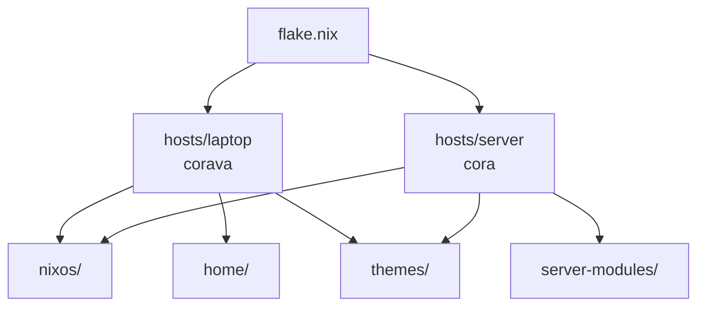

<!-- START doctoc generated TOC please keep comment here to allow auto update -->
<!-- DON'T EDIT THIS SECTION, INSTEAD RE-RUN doctoc TO UPDATE -->

- [Nixy](#nixy)
  - [Requirements](#requirements)
  - [Layout](#layout)
  - [Installation](#installation)
  - [Documentation](#documentation)

<!-- END doctoc generated TOC please keep comment here to allow auto update -->

[//]: # (This file is autogenerated)
<div align="center">
    
</div>

# Nixy

<div align="center">
    <a href="https://nixos.org">
        
    </a>
    <a href="https://hypr.land">
        
    </a>
    <a href="https://github.com/anotherhadi/nixy/blob/main/LICENSE">
        
    </a>
</div>

NixOS flake for two hosts: a Hyprland laptop (`corava`) and a self-hosted
server (`cora`) reachable through a Cloudflare Tunnel. Built on home-manager,
Stylix, sops-nix and nvf. Upstream: [anotherhadi/nixy](https://github.com/anotherhadi/nixy).


## Requirements

- NixOS 26.05 (`nixpkgs` and `home-manager` follow `nixos-26.05` / `release-26.05`)
- Flakes enabled
- A machine you can reinstall or rebuild: the first `nixos-rebuild switch` replaces the system configuration

## Layout



| Path | Contents |
|---|---|
| `hosts/<name>/` | `configuration.nix` (system), `home.nix` (user), `variables.nix` (hostname, theme, locale), `secrets/` (sops) |
| `nixos/` | System modules: audio, bluetooth, bootloader, kernel hardening, fprintd, YubiKey, podman, libvirt |
| `home/programs/` | Apps configured with home-manager, split into `gui/`, `tui/`, `cyber/` and `group/` |
| `home/system/` | Desktop environment: Hyprland, Waybar, hyprlock, hypridle, swaync, tofi |
| `themes/` | Stylix themes (`darkviolet`, `nixy`, `rose-pine`, `zen`) |
| `server-modules/` | Server services: Gitea, CyberChef, cloudflared, fail2ban, ClamAV |

## Installation

1. [Fork](https://github.com/anotherhadi/nixy/fork) this repository and clone it:

   ```sh
   git clone https://github.com/anotherhadi/nixy ~/.config/nixos
   ```

2. Copy `hosts/laptop`, rename the copy to your hostname, and edit its `variables.nix`.
3. Replace the copied `hardware-configuration.nix` with the one generated for your machine.
4. Register the host under `nixosConfigurations` in `flake.nix`.
5. Build and switch:

   ```sh
   sudo nixos-rebuild switch --flake ~/.config/nixos#yourhostname
   ```

> [!IMPORTANT]
> `# CHANGEME` comments mark values you must change. List them with `rg "CHANGEME" ~/.config/nixos`.

> [!TIP]
> Flakes only see files tracked by git. Run `git add .` after creating a file.

## Documentation

- [SERVER](docs/SERVER.md): services, containers and the Cloudflare Tunnel on `cora`
- [SECURITY](docs/SECURITY.md): hardening on the laptop and the server
- [SANDBOX](docs/SANDBOX.md): nixpak sandboxes for desktop apps and Claude Code
- [IMPERMANENCE](docs/IMPERMANENCE.md): migrating the laptop to a tmpfs root
- [HYPRLAND](docs/HYPRLAND.md): Lua configuration and how to change it
- [THEMES](docs/THEMES.md): choose or create a theme
- [NEOVIM](docs/NEOVIM.md): use the Neovim config in your own flake
- [GROUPS](docs/GROUPS.md): reusable package groups (`dev`, `cybersecurity`)
- [CONTRIBUTING](docs/CONTRIBUTING.md): how to contribute
- [LICENSE](LICENSE): MIT

Wallpapers come from [awesome-wallpapers](https://github.com/anotherhadi/awesome-wallpapers).

Mirrors: [GitHub](https://github.com/anotherhadi/nixy), [GitLab](https://gitlab.com/anotherhadi_mirror/nixy), [Gitea](https://git.hadi.icu/anotherhadi/nixy)
