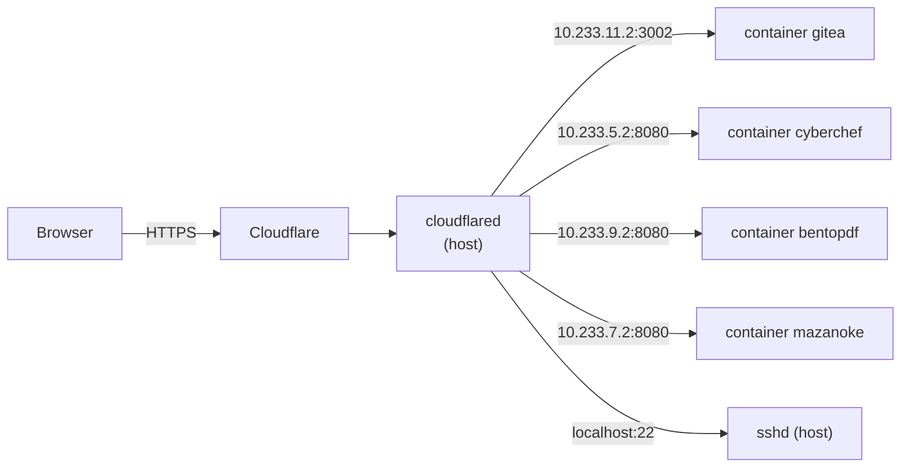

# Server

`hosts/server` builds the `cora` configuration: a NixOS machine that runs its services in NixOS containers and is reachable only through a Cloudflare Tunnel.

Build it with `sudo nixos-rebuild switch --flake ~/.config/nixos#cora`.

## Variables

Set in `hosts/server/variables.nix`:

| Variable | Used for |
|---|---|
| `domain` | Public hostnames: `<service>.<domain>` |
| `tunnelId` | ID of the Cloudflare tunnel in `server-modules/cloudflared.nix` |
| `networkInterface` | WAN interface for container NAT (`eno1`) |

The tunnel credentials come from the sops secret `cloudflared-token`.

## Request path

### How a request reaches a service



Each module adds its own `ingress` entry to `services.cloudflared.tunnels.<tunnelId>`. Any hostname without an entry gets `http_status:404`.

## Modules

Imported by `hosts/server/configuration.nix`:

| Module | Hostname | Runs as | Notes |
|---|---|---|---|
| `gitea.nix` | `git.<domain>` | container `gitea`, port 3002 | PostgreSQL inside the container, `/var/lib/gitea` bind-mounted, outbound internet allowed |
| `cyberchef.nix` | `cyberchef.<domain>` | container, port 8080 | |
| `bentopdf.nix` | `pdf.<domain>` | container, port 8080 | |
| `mazanoke.nix` | `mazanoke.<domain>` | container, port 8080 | |
| `ssh.nix` | `ssh.<domain>` | host, port 22 | See [SECURITY](SECURITY.md#server) |
| `cloudflared.nix` | none | host | Tunnel service, restarts every 5 s, 10 starts per 300 s |
| `firewall.nix`, `fail2ban.nix`, `kernel-hardening.nix`, `clamav.nix` | none | host | See [SECURITY](SECURITY.md#server) |
| `performance.nix` | none | host | zram swap (zstd, 50% of RAM), journald capped at 500 MB and one month |

Present in `server-modules/` but not imported:

| Module | Content |
|---|---|
| `adguardhome.nix` | AdGuard Home on port 3000, DNS on port 53, `adguard.<domain>` |
| `arr.nix` | Media stack (`media`, `demandemedia`, `bazarr`, `prowlarr`, `radarr`, `sonarr`, `transmission` hostnames) |
| `blog.nix` | Two nginx sites in container `blog`, on ports 8080 and 8081, for `<domain>` and `www.<domain>` |
| `umami.nix` | Umami analytics, container port 8080, `umami.<domain>` |

Import one in `hosts/server/configuration.nix` to enable it.

## Containers

`mk-container.nix` exports `mkContainer`, which every container module uses.

| Argument | Default | Effect |
|---|---|---|
| `name` | required | Container name. The host interface is `ve-<name>`, limited to 15 characters (checked by an assertion) |
| `hostIp`, `containerIp` | required | Private network. Convention: `10.233.N.1` and `10.233.N.2` |
| `internet` | `false` | NAT outbound traffic through `externalInterface` |
| `externalInterface` | `config.var.networkInterface` | WAN interface for NAT |
| `bindMounts` | `{}` | Host paths mounted in the container |
| `nixosConfig` | required | NixOS module of the container |

Every container gets `privateNetwork = true`, `autoStart = true` and hardening for `services.nginx` (no server tokens, restricted namespaces and address families).

`firewall.nix` sets the `FORWARD` policy to `DROP`. With `internet = true`, `mkContainer` inserts rules that accept new outbound connections from the container, drop traffic to `192.168.0.0/16`, `172.16.0.0/12` and `10.0.0.0/8`, and accept return traffic. Containers without `internet` cannot reach the LAN, the internet or each other.

Subnets in use: `10.233.3` (blog), `10.233.5` (cyberchef), `10.233.7` (mazanoke), `10.233.9` (bentopdf), `10.233.10` (umami), `10.233.11` (gitea).

## Add a service

1. Copy `server-modules/cyberchef.nix`.
2. Change `name`, pick an unused `10.233.N.x` pair, and set the container's listening port in `networking.firewall.allowedTCPPorts`.
3. Change the `ingress."<name>.${config.var.domain}"` line to the container IP and port.
4. Add the file to `imports` in `hosts/server/configuration.nix`, then `git add` it and rebuild.

## Set up the tunnel

The commands come from the comments in `server-modules/cloudflared.nix`:

```sh
cloudflared tunnel login
cloudflared tunnel create YourTunnelName
```

Put the tunnel ID in `tunnelId` and the credentials file content in the sops secret `cloudflared-token`.

TODO: document how DNS records and Cloudflare Access are configured; they live in the Cloudflare dashboard, not in this repository.
